<!-- ============================================================ -->
<!--  ALI HASSAN — GitHub Profile README                          -->
<!--  Style: Clean Professional + Animations                      -->
<!--  Live profile repo: github.com/alihassanashraf/alihassanashraf -->
<!-- ============================================================ -->

---

### About

I am a **BS Artificial Intelligence** student at **Superior University, Lahore**, focused on Python, Object-Oriented Programming, and applied AI.

Alongside my studies, I build practical software tools — including browser-based video editors — and run a **video ads service** for brands and businesses.

**Current focus:** strengthening my AI & software-engineering foundation while shipping real, usable projects.

 

### What I Do

---

### Tech Stack & Tools

---

### AI Video Generation Tools I Use

-FF6A00?style=for-the-badge&logoColor=white)

**Also:** Prompt Engineering for ChatGPT · Claude · Gemini — text, image & video prompts

---

### Featured Projects

| | |
|---|---|
| **🎞️ CutFlow Studio** | Premiere-level browser video editor — multi-track timeline, 22 transitions, 60+ effects, chroma key, captions, WebCodecs MP4 export. One single HTML file, no backend. |
| **✂️ AutoCut Studio** | Auto video editor — auto captions, silence removal, scene detection, pics + voice slideshow maker (9:16 / 16:9). |
| **📚 LMS Study Agent** | Personal study system — SGPA/CGPA projection, deadline watch, 4 AM lecture prep from LMS material. |

  
  

---

### Trophies

---

### Stats

---

### Contribution Snake

<picture>
  <source media="(prefers-color-scheme: dark)" srcset="https://raw.githubusercontent.com/alihassanashraf/alihassanashraf/output/github-contribution-grid-snake-dark.svg" />
  <source media="(prefers-color-scheme: light)" srcset="https://raw.githubusercontent.com/alihassanashraf/alihassanashraf/output/github-contribution-grid-snake.svg" />
  
</picture>

---

### Connect

